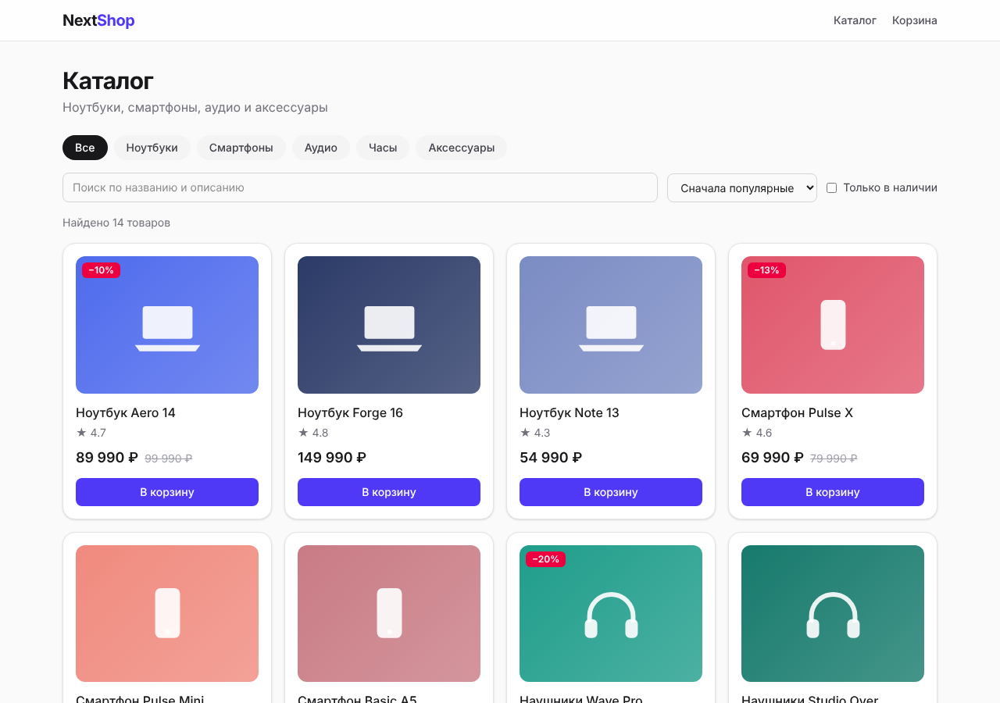
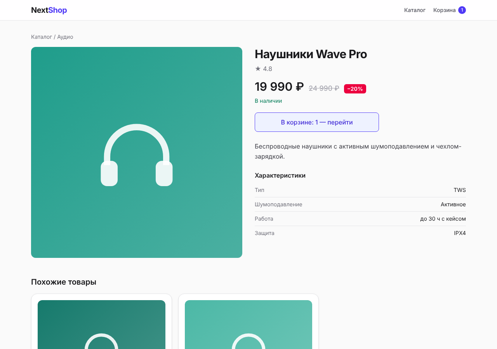

# NextShop — интернет-магазин на Next.js

Учебный проект: витрина магазина техники с каталогом, фильтрами, страницами товаров, корзиной и оформлением заказа.

**Демо:** https://gev566.github.io/nextjs-shop/



## Стек

- **Next.js 15** (App Router) и **React 19**
- **TypeScript** (strict)
- **Tailwind CSS 4**
- **Zustand** — корзина с сохранением в `localStorage`
- **Vitest** + **Testing Library** — 40 тестов
- **GitHub Actions** — линтер, проверка типов, тесты, сборка и деплой на GitHub Pages

## Что умеет

- Каталог: категории, поиск, сортировка, «только в наличии». Фильтры хранятся в URL, поэтому ссылкой с фильтрами можно поделиться.
- Страницы товаров собираются заранее (`generateStaticParams`), у каждой свои `title` и `description` (`generateMetadata`).
- Корзина: количество в пределах остатка, пересчёт суммы, бесплатная доставка от 50 000 ₽, данные сохраняются после перезагрузки.
- Оформление заказа: валидация полей, фокус на первом поле с ошибкой, `aria-invalid` для экранных дикторов. Заказ никуда не отправляется — это демо.
- Адаптивная вёрстка, страница 404.



## Как устроено

```
src/
  app/            страницы (App Router): каталог, товар, корзина, оформление, 404
  components/     Catalog, ProductCard, CartView, CheckoutForm, Header …
  lib/            логика без UI: фильтры каталога, корзина, валидация, форматирование
  data/           учебный каталог товаров (названия выдуманы)
```

Логика вынесена в `src/lib` и покрыта unit-тестами отдельно от компонентов.
Сайт собирается в статику (`output: "export"`), поэтому серверных функций нет: фильтры каталога работают на клиенте через `useSearchParams`, а корзина рендерится после гидратации, чтобы HTML с сервера совпадал с клиентом.

## Запуск

```bash
npm install
npm run dev        # http://localhost:3000
npm test           # тесты
npm run build      # статическая сборка в out/
```

## Автор

Геворг Баблоян — [gev566.github.io](https://gev566.github.io/) · Telegram [@Gevorg_Babloyan](https://t.me/Gevorg_Babloyan)
